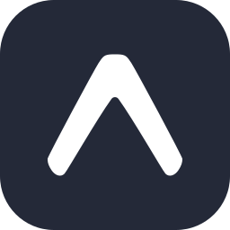
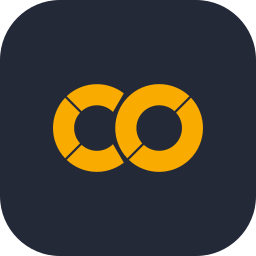

# Mohamad Reza Nurpadilah

Junior Fullstack Developer &amp; Manual QA

 

I build web applications end to end, from database and API to the interface, and test them manually before they ship. Most of my work is in Laravel and Vue, with recent projects in React, Next.js, and mobile apps built with Expo. For testing I use Postman, Selenium, JMeter, and Jira.

## Tech Stack

<table>
  <tr>
    <td><b>Frontend</b></td>
    <td></td>
  </tr>
  <tr>
    <td><b>Backend</b></td>
    <td> </td>
  </tr>
  <tr>
    <td><b>Database</b></td>
    <td></td>
  </tr>
  <tr>
    <td><b>Mobile</b></td>
    <td> </td>
  </tr>
  <tr>
    <td><b>Testing</b></td>
    <td> </td>
  </tr>
  <tr>
    <td><b>Tools</b></td>
    <td> </td>
  </tr>
</table>

## Selected Projects

| Project | Description | Stack |
|:--|:--|:--|
| [Street Distro E-Commerce](https://github.com/reza-programer/street-distro-ecommerce-with-api-ongkir-and-midtrans) | Online store with shipping-rate API and Midtrans payments | TypeScript |
| [POS Cafe](https://github.com/reza-programer/poin-of-sales-sistem---pos-cafe) | Point-of-sale system for cafe operations | TypeScript |
| [Sistem Akademik Kampus](https://github.com/reza-programer/sistem-akademik-kampus) | Campus academic information system | Vue |
| [Audit System](https://github.com/reza-programer/Audit-System) | Internal audit management system | Vue |
| [Member App](https://github.com/reza-programer/Member-App) | Membership management application | PHP |
| [Pasir Bunut Digital](https://github.com/reza-programer/pasir-bunut-digital) | Digital information platform for Pasir Bunut | TypeScript |
